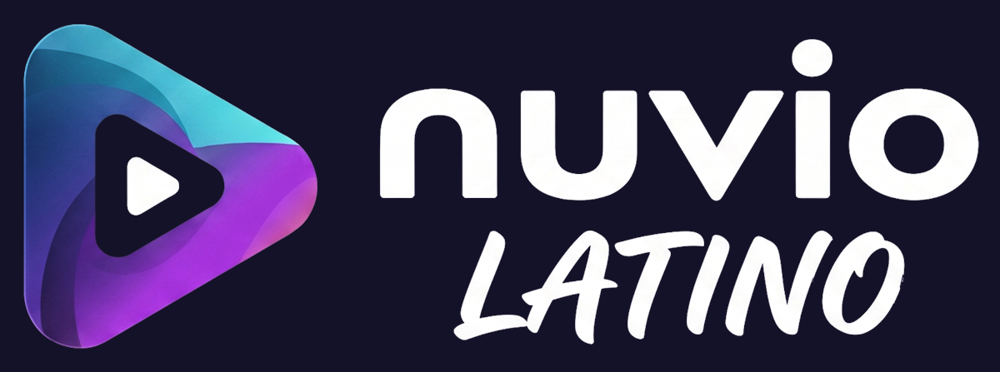
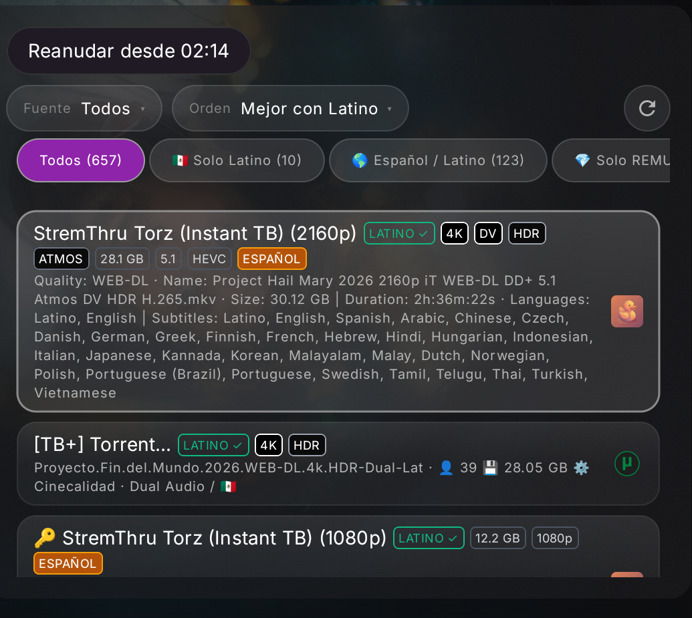
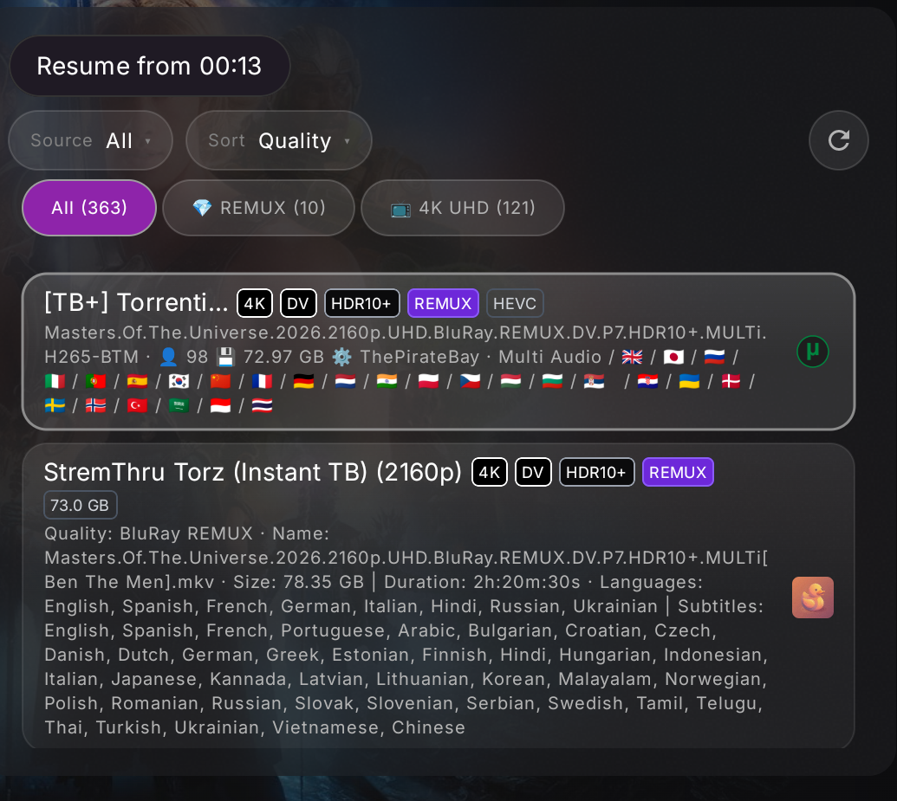
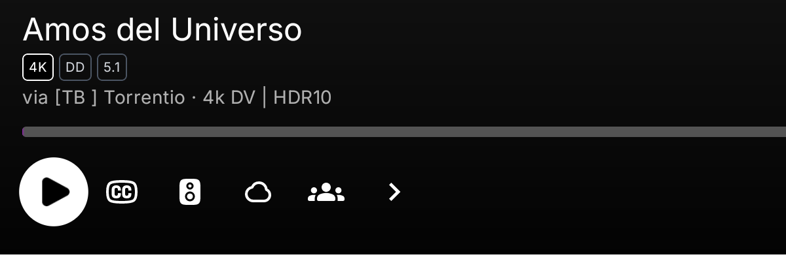

  

# Nuvio Latino

**Nuvio TV, optimizado para quien busca audio latino.**

Una versión no oficial de Nuvio TV que te dice, antes de reproducir, cuáles fuentes tienen audio en español latino.

 

---

## Capturas

<table>
  <tr>
    <td width="50%">
      
    </td>
    <td width="50%">
      
    </td>
  </tr>
  <tr>
    <td align="center">Español: Solo Latino, audio confirmado y calidad.</td>
    <td align="center">English: Nuvio normal, con insignias técnicas.</td>
  </tr>
</table>

  
   
  En el reproductor ves la calidad y el audio reales de la fuente.

---

## Qué hace

- **Te dice si el audio es latino** sin abrir fuente por fuente.
- **Filtra y ordena** para que las mejores fuentes aparezcan primero.
- **Muestra la calidad** de cada fuente: 4K, HDR, Atmos, DTS, 5.1 y más.
- **Cambia con el idioma de la app**: español activa las funciones latinas; inglés deja una experiencia Nuvio normal.

---

## Insignias

| Insignia | Qué significa |
|---|---|
| `LATINO ✓` | Audio latino confirmado. Verde sólido: comprobado en el archivo. Verde con borde: la tarjeta lo indica claramente. |
| `LATINO ?` | Puede ser latino, pero no está confirmado. |
| `ESPAÑOL` | Hay audio en español, pero no se sabe si es latino o de España. |
| `SIN LATINO` | No se encontró español en el audio. |

Solo se tiene en cuenta el **audio**, nunca los subtítulos.

---

## Español e inglés

| | Español | English |
|---|---|---|
| `Solo Latino` y `Mejor con Latino` | Sí | No |
| Insignias latinas | Sí | No |
| Insignias de calidad y audio | Sí | Sí |
| Comportamiento | Enfoque latino | Nuvio normal |

Los títulos, descripciones y géneros siguen el idioma de la app. En TMDb, usa **“Igual que la app”** para mantenerlos sincronizados.

---

## Instalar

Descarga el APK desde [Releases](https://github.com/Ardila424/NuvioLatino/releases/latest).

| Dispositivo | Archivo |
|---|---|
| Onn, Fire TV Stick y cajas de 32 bits | `app-full-armeabi-v7a-release.apk` |
| NVIDIA Shield, Google TV 4K y cajas de 64 bits | `app-full-arm64-v8a-release.apk` |
| Si no estás seguro | `app-full-universal-release.apk` |

Instala el APK y agrega tus propias fuentes/addons. Nuvio Latino se instala **junto a** Nuvio TV.

---

## Addons recomendados

Nuvio Latino no incluye addons. Estos son los que mejores resultados me han dado para encontrar audio latino. **En mi caso uso TorBox** como servicio debrid.

| Addon | Por qué | Instalar |
|---|---|---|
| **Torrentio** | Muchas fuentes y filtros; permite configurar TorBox. | [Configurar Torrentio](https://torrentio.strem.fun/configure) |
| **LatinoBrid** | Enfocado en español latino; compatible con TorBox. | [Configurar LatinoBrid](https://latinobrid.stremx.net/configure) |
| **Duck Streams** | Configuración de AIOStreams con muchos scrapers; compatible con TorBox. | [Abrir Duck Streams](https://duckkota.gitlab.io/stremio-tools/) |

**Cómo instalarlos en Nuvio Latino:** Abre `Ajustes → Addons → Agregar addon`, pega el enlace que te da la página de configuración (termina en `manifest.json`) y confirma.

> Son proyectos de terceros: no están incluidos en Nuvio Latino y no estamos afiliados a ellos. Ten a mano tu cuenta/API key de TorBox si vas a usar debrid. Úsalos solo donde el contenido y el acceso estén permitidos.

---

## Importante

- **No incluye addons, scrapers ni contenido.** Todo depende de las fuentes que tú instales.
- **No está afiliado ni respaldado por Nuvio TV.** No reportes problemas de esta versión en los canales oficiales.
- Es un proyecto **GPL-3.0**. El crédito del proyecto original es de [Nuvio TV](https://github.com/NuvioMedia/NuvioTV). Si quieres apoyarlo: [nuvio.tv/support](https://nuvio.tv/support).

---

<strong>English</strong>

 

**Nuvio Latino** is an unofficial community fork of [Nuvio TV](https://github.com/NuvioMedia/NuvioTV) focused on Latin American Spanish audio.

It shows which sources actually have Latino audio with a clear `LATINO ✓` badge, a `Solo Latino` filter, and `Mejor con Latino` sorting. Quality and audio badges such as `4K`, `DV`, `HDR10`, `ATMOS`, `DTS`, `5.1` and `REMUX` are included too.

Switch the app to **English** to hide the Latino-specific filters and badges and keep a normal Nuvio experience. No add-ons or content are bundled; bring your own sources.

Not affiliated with the official NuvioTV project. **GPL-3.0**, all upstream notices preserved.

